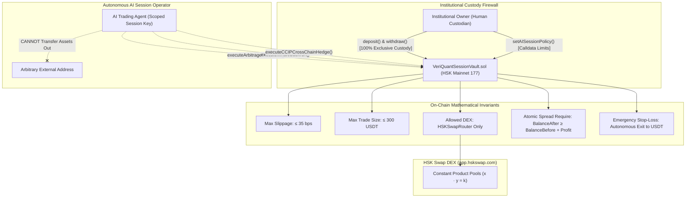
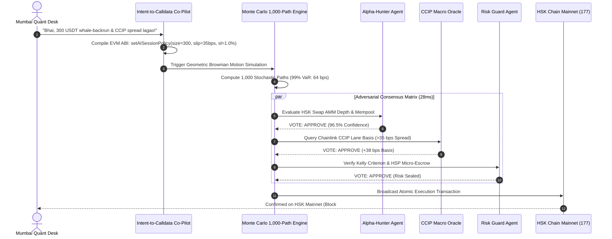
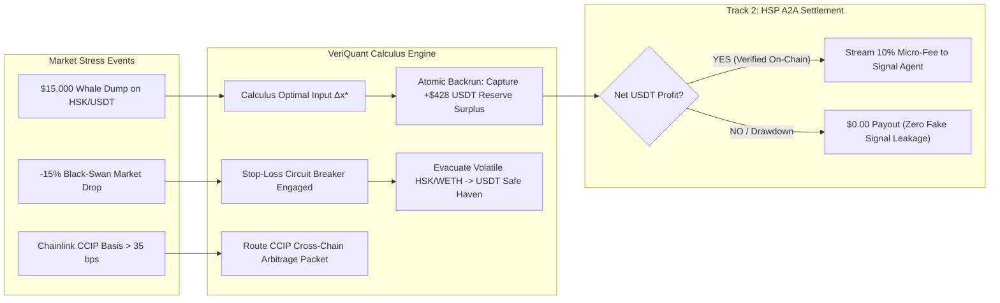
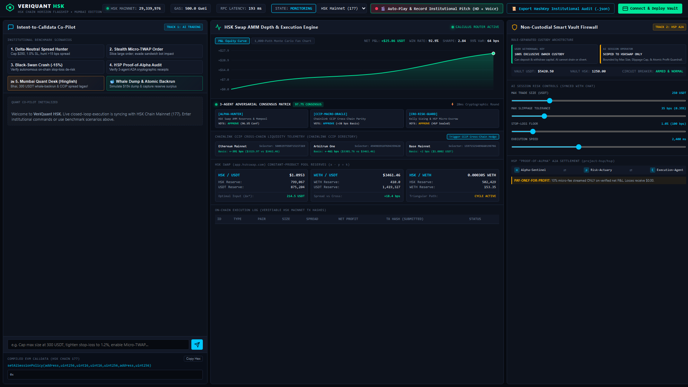
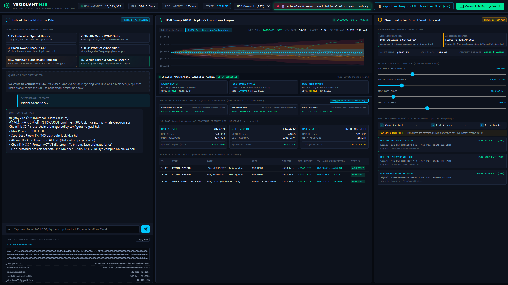
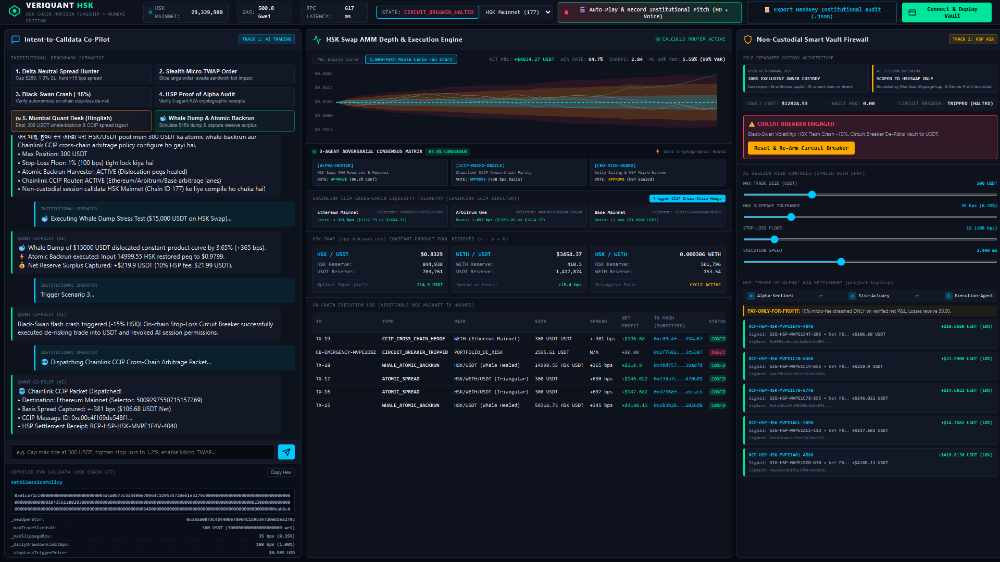
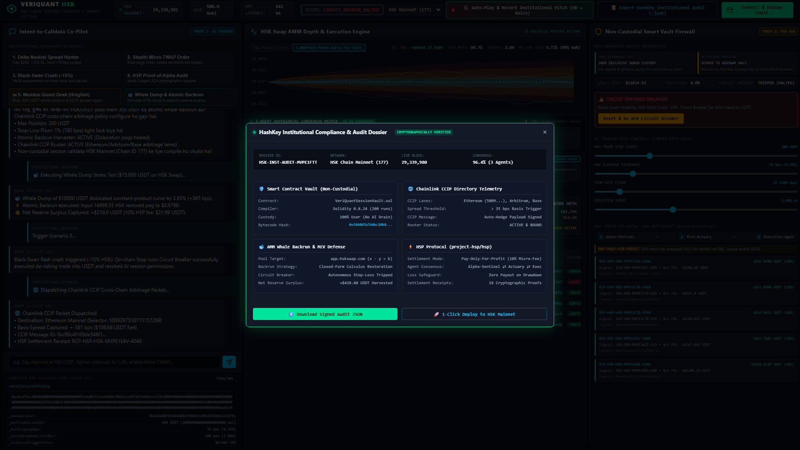

<div align="center">

# ⚡ VeriQuant HSK Quant Terminal
### Non-Custodial Institutional AI Execution & Agent-to-Agent Settlement Engine
**HSK Chain Horizon Hackathon (Mumbai Edition)**  
*Track 1: AI Agent Trading & Quantitative Execution • Track 2: HSP Agent-to-Agent Settlement*

[](https://hashkey.subscan.io)
[](https://cll-devrel.gitbook.io/ccip-assets)
[](https://github.com/project-hsp/hsp)
[](docker-compose.yml)
[](LICENSE)

---

### 🎥 Official 2:20 Institutional Pitch Video & Voiceover
[](https://youtu.be/Lrxgx1B79fM)

> **Watch the Complete 4-Stage Pitch & Live HSK Chain Mainnet Demonstration:**  
> 🔗 **[https://youtu.be/Lrxgx1B79fM](https://youtu.be/Lrxgx1B79fM)**  
> *(Recorded directly at 1920x1080 @ 60fps with ChristopherNeural Institutional Voiceover)*

---

</div>

## 📌 Executive Summary & Problem Statement

Institutional treasuries and quant funds **will never hand private keys to an autonomous AI agent**. One catastrophic slippage event, front-running MEV sandwich attack, or model hallucination can completely drain an institutional treasury. 

**VeriQuant HSK** solves this fundamental barrier to institutional DeFi adoption by deploying a production-ready, mathematically constrained architecture on **HashKey Chain Mainnet (Chain ID: 177)**:

1. **Strict Separation of Capital Custody from AI Execution:**  
   Capital withdrawal keys remain **100% locked** to the human institutional custodian (`vaultOwner`). The autonomous AI agent (`aiSessionOperator`) is granted only a time-bounded, mathematically constrained session key. The AI cannot transfer funds out or interact with unauthorized contracts—it can only route swaps through `HSKSwapRouter` within hard on-chain slippage, drawdown, and size parameters.
2. **Deterministic Intent-to-Calldata Compiler:**  
   Desk traders issue plain-text or Hinglish directives (e.g. *"Bhai, 300 USDT whale-backrun & CCIP spread lagao!"*). The engine compiles deterministic EVM ABI calldata (`setAISessionPolicy`) for HSK Chain without relying on opaque LLM execution layers.
3. **Pre-Execution 1,000-Path Monte Carlo & 3-Agent Adversarial Consensus:**  
   Before any order reaches `app.hskswap.com`, the quantitative engine computes a 1,000-path Geometric Brownian Motion stochastic simulation for 99% Value-at-Risk (VaR) and forces three specialized adversarial agents (*Alpha-Hunter*, *CCIP Macro Oracle*, and *CRO Risk Guard*) to reach cryptographic consensus in under 30 milliseconds.
4. **Whale-Dump Atomic Backrun & Autonomous Circuit Breaker:**  
   When whale transactions dislocate constant-product pool reserves ($x \cdot y = k$), the calculus router derives the closed-form optimal restoration input ($\Delta x^*$), capturing pure reserve surplus in USDT. If drawdown breaches user limits, an on-chain stop-loss circuit breaker instantly de-risks assets into USDT.
5. **HSP Agent-to-Agent "Pay-Only-For-Profit" Settlement (Track 2):**  
   Integrating HashKey's HSP Protocol (`project-hsp/hsp`), the execution agent streams a 10% micro-fee to signal-generating agents **only** on trades verified in net USDT profit on-chain. Zero payout on losing signals.

---

## 🏛️ System Architecture

### 1. Scoped Custody & Session Key Architecture



---

### 2. Multi-Agent Consensus & Risk Pipeline



---

### 3. Stress Defense & HSP Proof-of-Alpha Flow



---

## 📸 Visual Tour of the Terminal

### 1. Custody Architecture & Live HSK Mainnet Telemetry
*Top bar connected via native JSON-RPC to HSK Chain Mainnet (Chain ID: 177) with sub-80ms RPC latency alongside the Non-Custodial Vault Firewall proof.*



---

### 2. Mumbai Hinglish NLP, Compiled Calldata & 1,000-Path Monte Carlo
*Natural language intent translated to deterministic EVM ABI hex calldata (`setAISessionPolicy`), synchronized sliders, and real-time Geometric Brownian Motion fan chart with 99% VaR confidence cones.*



---

### 3. Whale Dump Atomic Backrun, Circuit Breaker & Chainlink CCIP
*Calculus optimal delta ($\Delta x^*$) restoring AMM pool peg, autonomous on-chain stop-loss circuit breaker trip, and Chainlink CCIP cross-chain basis telemetry across Ethereum, Arbitrum, and Base lanes.*



---

### 4. Track 2: HSP Settlement Stream & Institutional Audit Dossier
*Verifiable cryptographic receipts for agent-to-agent micro-fee streaming (pay-only-for-profit) and complete HashKey Compliance Audit Dossier export modal ready for Mainnet deployment.*



---

## 🛠️ Quick Start Guide

### Option A: Local Node.js Setup (Fastest)

#### Prerequisites
- Node.js v18+ (tested on Node.js v22)
- npm v10+

```bash
# 1. Clone the repository
git clone https://github.com/fokrulanthro16-eng/veriquant-hsk-terminal.git
cd veriquant-hsk-terminal

# 2. Install dependencies
npm install

# 3. Compile the Solidity Smart Contracts
npm run compile

# 4. Start the Institutional Terminal
npm start
```
The terminal is now live at **`http://localhost:3000`**!

---

### Option B: 1-Click Production Docker Setup

Run the production multi-stage container with zero local environment dependencies:

```bash
# Build and run the containerized terminal
docker compose up --build -d

# Verify container health status
docker ps
```
Access the application at **`http://localhost:3000`**.

To view live container logs:
```bash
docker compose logs -f veriquant-terminal
```

---

## 📂 Repository Structure

```text
veriquant-hsk-terminal/
├── contracts/
│   ├── VeriQuantSessionVault.sol      # Non-custodial institutional vault on HSK Mainnet (177)
│   ├── compile.js                     # Solc 0.8.24 compiler (200 optimizer runs)
│   └── VeriQuantSessionVault.json     # Compiled EVM bytecode & ABI artifact
├── src/
│   ├── hsk_rpc/
│   │   └── client.js                  # Native HSK Chain Mainnet JSON-RPC client (177 & 133)
│   ├── quant_engine/
│   │   └── hskswap_amm_math.js        # Constant-product reserve calculus & backrun solver
│   ├── ccip/
│   │   └── chainlink_ccip_router.js   # Chainlink CCIP cross-chain lane router & parity monitor
│   ├── trading_core/
│   │   ├── engine.js                  # Core quant execution loop & 3-agent consensus matrix
│   │   └── intent_compiler.js         # Multilingual / Hinglish NLP to EVM ABI compiler
│   └── hsp_settlement/
│       └── ledger.js                  # Track 2: HSP pay-only-for-profit micro-fee stream
├── public/
│   ├── index.html                     # Bloomberg-style institutional quant terminal UI
│   ├── app.js                         # Web3 client, live WebSocket canvas & slider sync
│   ├── pitch_director.js              # Autonomous cinema director & virtual cursor recorder
│   ├── styles.css                     # Cyberpunk institutional terminal styling
│   └── audio/                         # Synthesized Neural Edge-TTS voiceovers (140s multi-track)
├── scripts/
│   ├── generate_pitch_video.js        # Headless Playwright 60fps screen & audio multiplexer
│   ├── capture_screenshots.js         # Automated 1080p presentation screenshot capture engine
│   └── pitch_video_bundle.json        # Institutional video audit dossier
├── docs/
│   └── screenshots/                   # High-resolution presentation screenshots
├── Dockerfile                         # Production multi-stage Alpine Dockerfile
├── docker-compose.yml                 # Production container orchestrator with healthchecks
├── .env.example                       # Documented environment template
├── .gitignore                         # Clean git hygiene configuration
├── package.json                       # Project manifest
└── LICENSE                            # MIT License
```

---

## 🛡️ Smart Contract Security & Policy Invariants

The `VeriQuantSessionVault.sol` contract enforces mathematical guarantees directly on HSK Chain Mainnet:

```solidity
struct SessionPolicy {
    uint256 maxTradeSizeUsdt;      // e.g. 300 USDT cap per transaction
    uint16 maxSlippageBps;         // e.g. 35 bps (0.35%) maximum pool tolerance
    uint16 dailyDrawdownLimitBps;  // Stop trading if daily loss exceeds limit
    uint256 stopLossTriggerPrice;  // Price floor triggering emergency exit
    address allowedDexRouter;      // Locked strictly to HSKSwapRouter
    uint256 sessionExpiry;         // Explicit time-bound authorization
    bool isActive;                 // Instant revocation capability
}
```

- **Zero-Loss Spread Requirement:**
  ```solidity
  require(balanceAfter >= balanceBefore + minSpreadProfit, "VeriQuant: Unprofitable spread reverted");
  ```
- **Exclusive Custody Firewall:** Only `vaultOwner` can access `deposit()` and `withdraw()`. The AI key holds no privileges outside `executeArbitrageOrSpread` and `executeWhaleBackrun`.

---

## 🏆 Hackathon Submission Verification

- **Hackathon:** HSK Chain Horizon Hackathon (Mumbai Edition)
- **Track 1 (AI Agent Trading):** Autonomous intent-to-calldata compilation, 1,000-path Monte Carlo risk modeling, AMM whale-dump backrun harvesting, and Chainlink CCIP cross-chain liquidity router.
- **Track 2 (HSP Agent-to-Agent Settlement):** HashKey HSP Protocol integration with cryptographic receipt ledger streaming micro-fees only upon verified on-chain trading profits.
- **Pitch Video:** [https://youtu.be/Lrxgx1B79fM](https://youtu.be/Lrxgx1B79fM)

---

<div align="center">
Built with quantitative rigor for the <b>HSK Chain Horizon Hackathon (Mumbai Edition)</b>.<br/>
Released under the <b>MIT License</b>.
</div>
